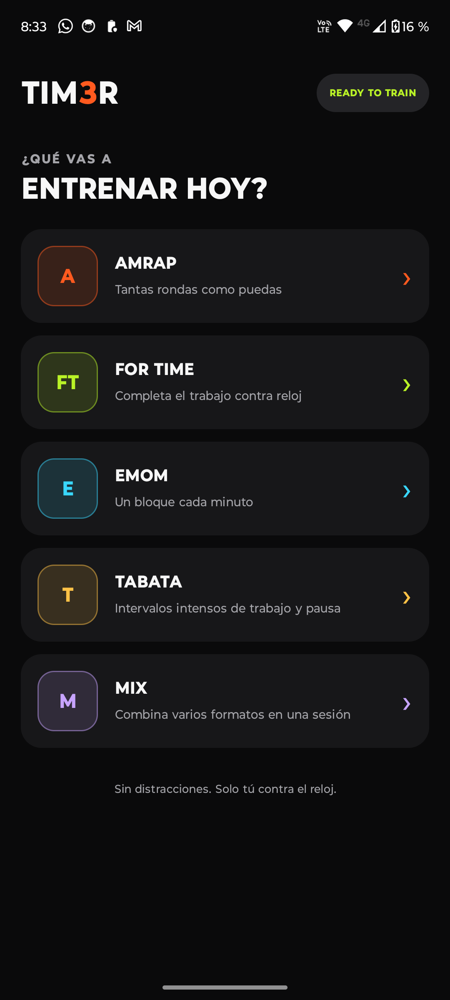
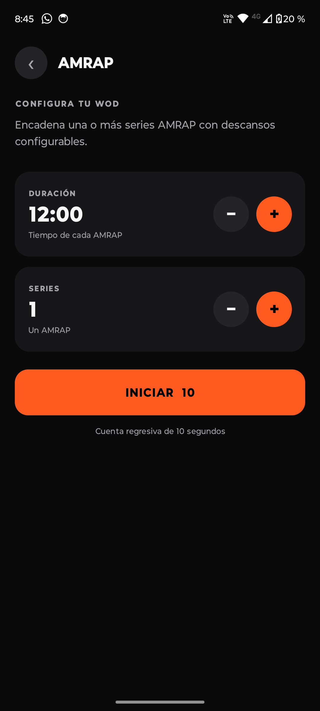
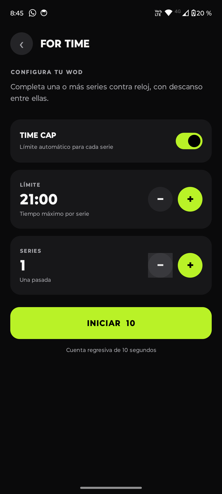
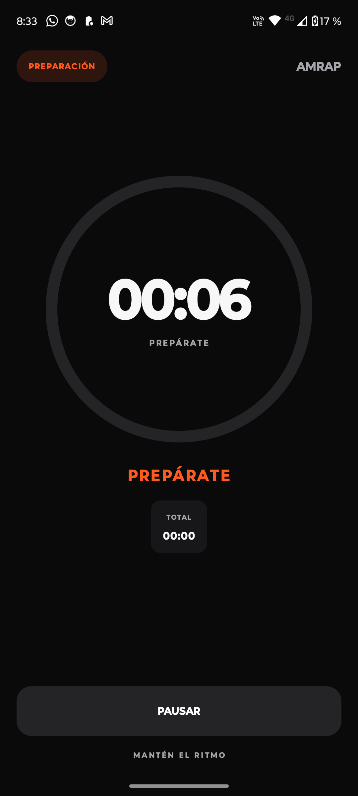

# TIM3R

<p align="center">
  <strong>Un temporizador Android simple, rápido y sin distracciones para CrossFit y entrenamiento funcional.</strong>
</p>

<p align="center">
  <a href="https://github.com/felipendelicia/tim3r/actions/workflows/android.yml"></a>
  
  
  
  <a href="LICENSE"></a>
</p>

TIM3R está pensada para esos momentos en los que solo necesitas configurar el WOD, apoyar el teléfono y entrenar. Funciona completamente en el dispositivo, mantiene la pantalla activa durante la sesión y utiliza el reloj monotónico de Android para evitar desfasajes aunque la interfaz se recomponga o la aplicación pase momentáneamente a segundo plano.

## Capturas

| Inicio | Configuración AMRAP |
| :---: | :---: |
|  |  |

| Configuración For Time | Temporizador en ejecución |
| :---: | :---: |
|  |  |

## Modos de entrenamiento

### AMRAP

Configura la duración de cada AMRAP, concatena varias series y define el descanso entre ellas. La aplicación alterna automáticamente entre trabajo y recuperación e indica la serie actual.

### For Time

Cronómetro ascendente para completar el trabajo lo más rápido posible. Admite:

- Una o más series.
- Botón **Terminé** para cerrar cada serie manualmente.
- Descansos configurables entre series.
- `Time cap` opcional por serie.
- Avance automático al alcanzar el límite.

### EMOM

Define la duración de cada intervalo y la cantidad de rondas. Una nueva ronda comienza automáticamente al terminar el intervalo; el tiempo restante funciona como recuperación.

### Tabata

Alterna periodos configurables de trabajo y descanso. El preset inicial utiliza el formato clásico de `8 × 20 s / 10 s`.

### Mix

Construye una sesión de hasta ocho bloques combinando AMRAP, For Time, EMOM y Tabata, con duración y transición configurables para cada bloque.

## Características

- Cuenta regresiva de preparación de 10 segundos.
- Pausa y reanudación sin perder precisión.
- Señales sonoras y vibración en momentos clave.
- Indicadores de serie, ronda, bloque y tiempo total.
- Interfaz oscura de alto contraste, legible a distancia.
- Pantalla activa durante todo el entrenamiento.
- Funcionamiento local, sin cuenta, anuncios ni backend.
- Soporte desde Android 8.0 (`API 26`).

## Arquitectura

La aplicación separa la interfaz del motor temporal:

```text
app/src/main/java/com/felipe/tim3r/
├── MainActivity.kt          # Interfaz con Jetpack Compose
├── MainViewModel.kt         # Estado, configuración y ciclo de la sesión
├── domain/
│   └── TimerEngine.kt       # Máquina de estados y cálculos temporales
└── ui/theme/
    └── Theme.kt             # Colores y tema visual
```

`TimerEngine` es Kotlin puro y recibe explícitamente el tiempo monotónico. Los ticks solo actualizan la representación visual: nunca incrementan un contador mutable. De esta forma, un frame perdido o una recomposición no introducen deriva en el cronómetro.

## Tecnologías

- Kotlin
- Jetpack Compose
- Material 3
- Android ViewModel y StateFlow
- Coroutines
- Gradle Kotlin DSL
- JUnit 4

## Requisitos

- Android Studio compatible con AGP 8.13 o superior.
- JDK 17 o superior.
- Android SDK 36.
- Un dispositivo o emulador con Android 8.0 o superior.

## Ejecutar el proyecto

1. Clona el repositorio:

   ```bash
   git clone https://github.com/felipendelicia/tim3r.git
   cd tim3r
   ```

2. Abre el directorio en Android Studio y espera la sincronización de Gradle.
3. Selecciona un dispositivo o emulador.
4. Ejecuta la configuración `app`.

También puedes compilar desde la terminal:

```bash
./gradlew assembleDebug
```

El APK se genera en:

```text
app/build/outputs/apk/debug/app-debug.apk
```

Para instalarlo en un teléfono conectado mediante ADB:

```bash
adb install -r app/build/outputs/apk/debug/app-debug.apk
```

## Pruebas y calidad

```bash
./gradlew lintDebug testDebugUnitTest assembleDebug
```

La suite cubre límites exactos, pausa y reanudación, series AMRAP, series For Time manuales y con `time cap`, EMOM, Tabata y transiciones tardías en Mix.

Cada push a `main` también ejecuta estas verificaciones mediante GitHub Actions y publica el APK `debug` como artefacto del workflow.

## Roadmap

- Historial de entrenamientos y resultados.
- Presets y WODs favoritos.
- Registro de rondas y repeticiones durante AMRAP.
- Ejecución mediante foreground service.
- Avisos de voz configurables.
- Soporte para Wear OS.
- Exportación y sincronización opcional.

## Contribuir

Las ideas, reportes de errores y pull requests son bienvenidos. Para cambios importantes, abre primero un issue describiendo el caso de uso y el comportamiento esperado.

1. Haz un fork del proyecto.
2. Crea una rama: `git switch -c feature/mi-mejora`.
3. Ejecuta las pruebas.
4. Envía un pull request.

## Licencia

Distribuido bajo la licencia MIT. Consulta [`LICENSE`](LICENSE) para más información.
